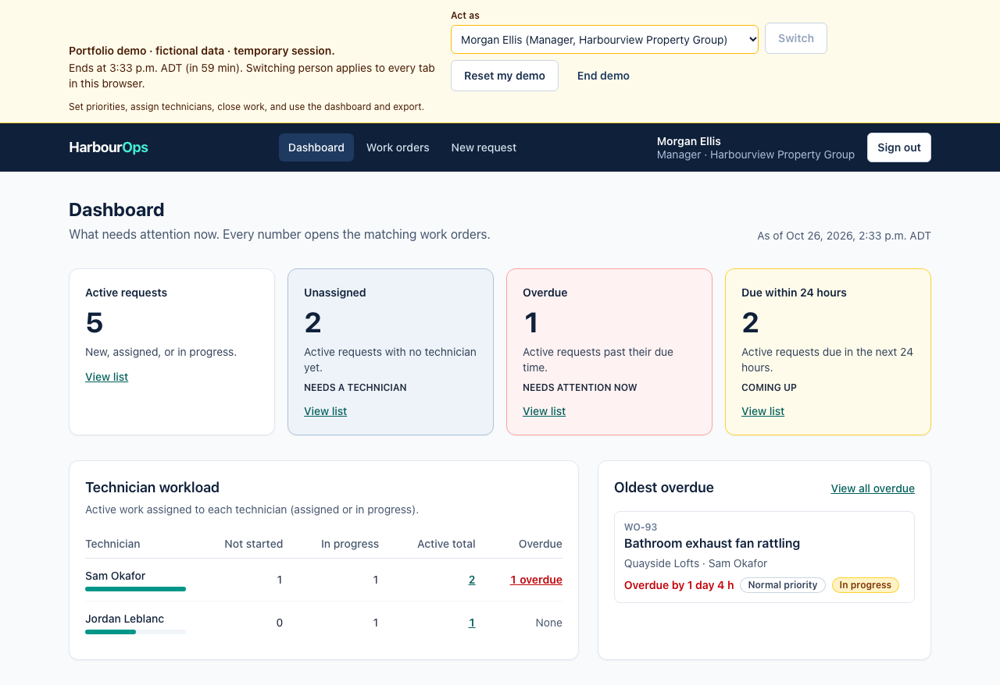
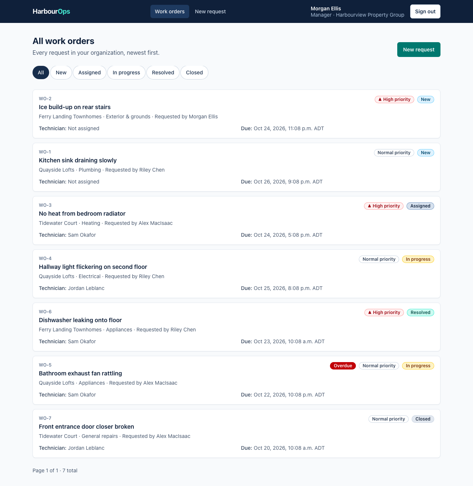
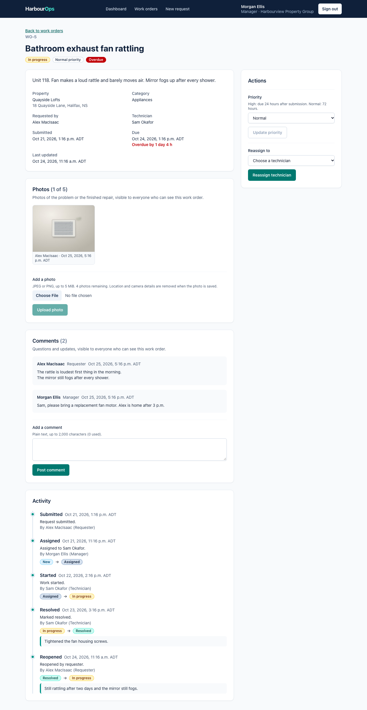
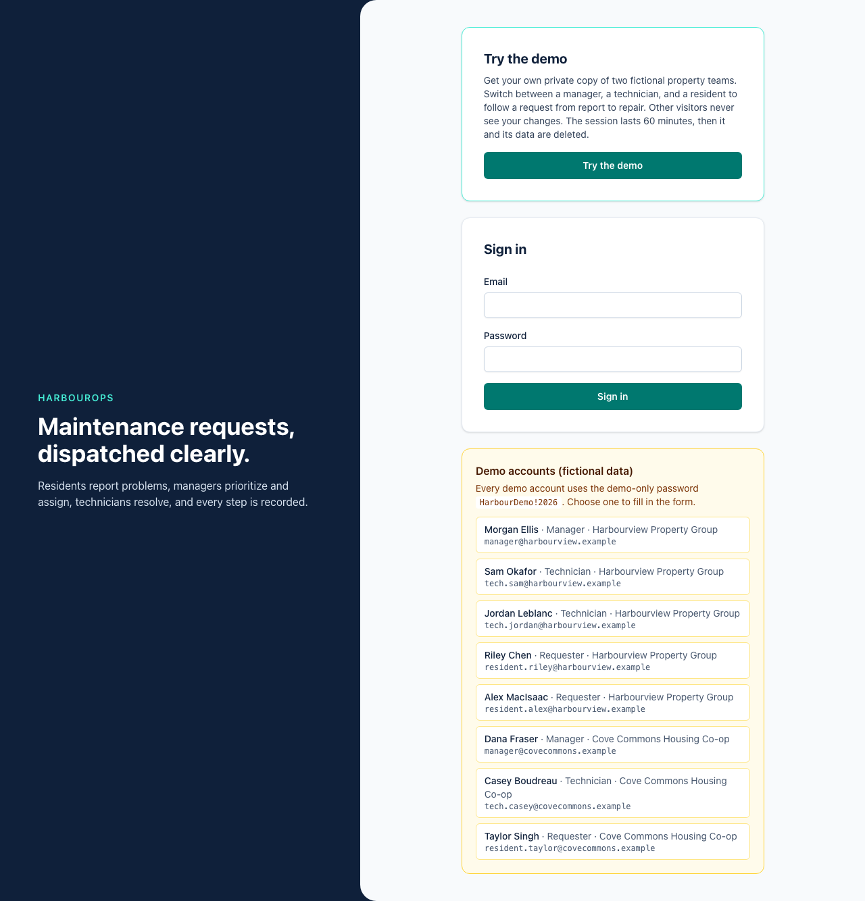
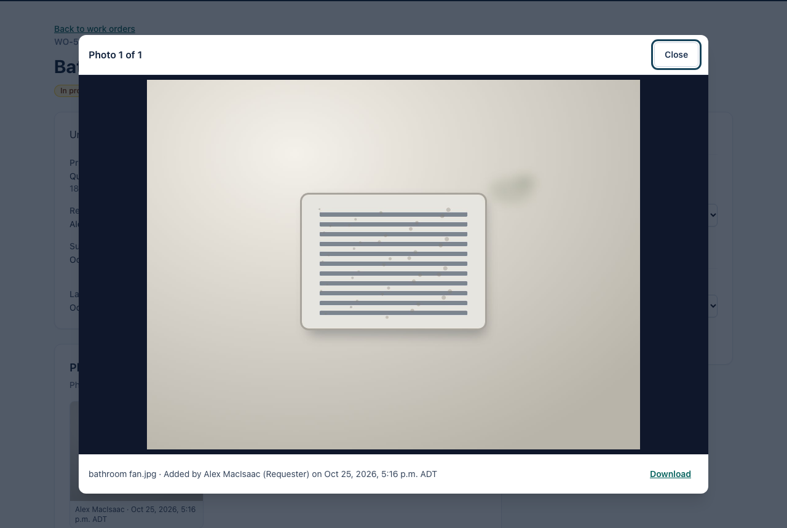
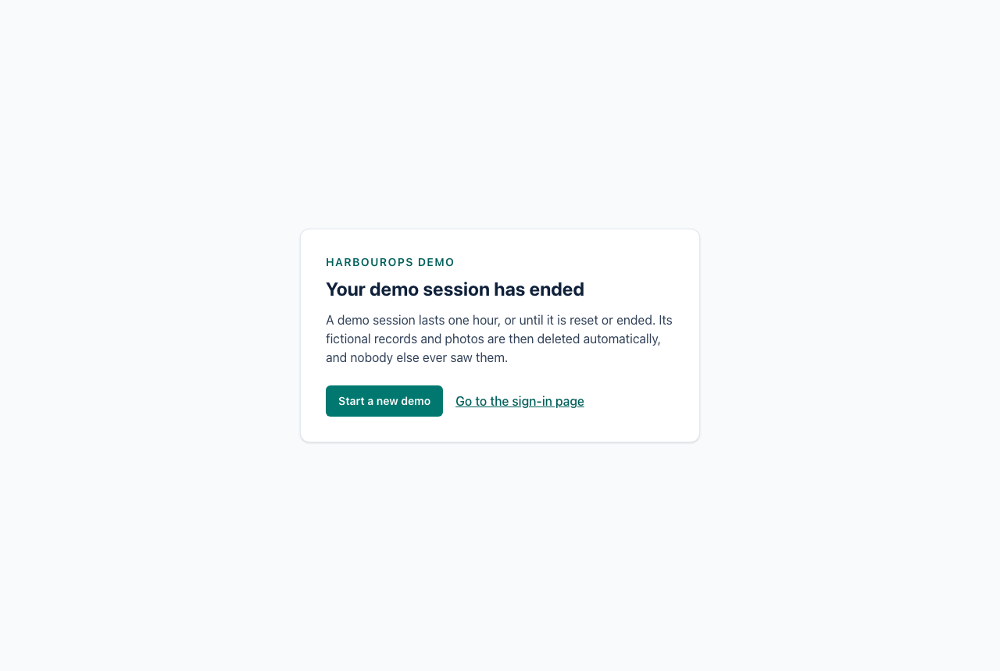
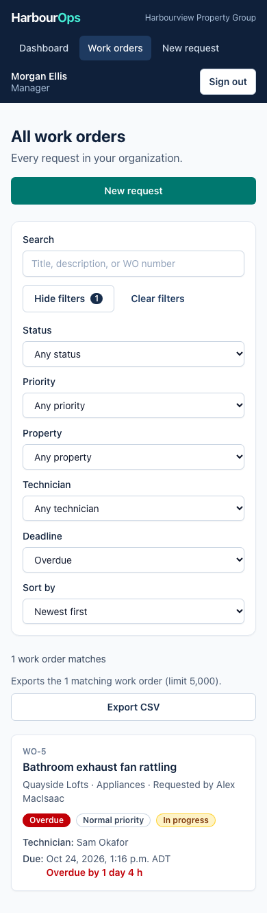
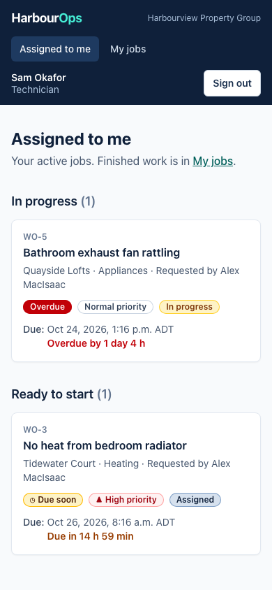

# HarbourOps

**Maintenance requests, dispatched clearly.** HarbourOps is a full-stack web app for property-management teams:

1. A resident reports a problem, with photos.
2. A manager sets its priority and assigns a technician.
3. The technician does the work and records the fix.
4. The manager closes it.

Every step is checked by the server and recorded in an activity history.

It is a **portfolio project** built to production habits: tested on a real database, documented trade-offs, measured performance, and a prepared (not yet executed) Azure deployment. All organizations, people, addresses, and requests are fictional; every email address uses the reserved `.example` domain.

> **Live demo: not deployed yet.** A link will be added here once it is. Until then, the [two-command local run](#try-it-locally) gives you the same "Try the demo" experience.



## The problem

Small property teams often run maintenance through email, phone calls, and spreadsheets. Requests get lost, nobody can say which jobs are overdue, residents can't tell what is happening, and there is no record of who did what. HarbourOps gives each role exactly the view and the actions it needs, and keeps an auditable history.

## Three roles, one workflow

| Role | Can see | Can do |
| --- | --- | --- |
| **Requester** (resident) | Only their own requests | Report a problem, add photos and comments, reopen a request with a reason after it was resolved |
| **Technician** | Only work currently assigned to them | Start the work, resolve it with a note, add photos and comments |
| **Manager** | Everything in their organization | Prioritize, assign and reassign, close, use the dashboard, export CSV |

**The workflow:** New → Assigned → In progress → Resolved → Closed, plus reopening a resolved request.
- **One endpoint and one rule per transition.**
- **Recorded together:** every change is saved in the same transaction as its audit event.
- **Isolated:** organizations can't see each other's data. Anything outside your view is a plain 404, so its existence isn't revealed.

## Try it locally

```bash
cp .env.example .env          # set POSTGRES_PASSWORD to any random string
docker compose up --build     # http://localhost:8088 (first build takes a few minutes)
```

Choose **Try the demo**. You get a **private, one-hour copy** of two fictional property teams. You can switch between a manager, a technician, a resident, and a manager from another organization (to see the isolation). Nothing you do is visible to anyone else. [docs/demo-script.md](docs/demo-script.md) is a five-minute walkthrough.

The local stack also lists shared demo accounts (password `HarbourDemo!2026`) for development. The hosted configuration turns those off.

## Screenshots





| Sign-in with "Try the demo" | Photo viewer | Demo ended | Filters on a phone | Technician queue (phone) |
| --- | --- | --- | --- | --- |
|  |  |  |  |  |

## What's in it

- **Workflow and permissions.**
  - **Server-enforced roles and organization boundaries,** backed by composite foreign keys in PostgreSQL.
  - **Optimistic concurrency:** a stale edit gets 409, with a "load latest" recovery that keeps what you typed.
- **Finding work.**
  - **Search:** PostgreSQL full-text search with prefix matching, or a reference like `WO-12`.
  - **Filters and sorting:** filters for status, priority, property, technician, and deadline, plus stable sorting and server paging. Everything lives in the URL, so a refresh or a shared link keeps it.
  - **Deadline labels** are exact to the microsecond, in Halifax time.
- **For managers.**
  - **A dashboard** whose every number links to exactly the matching list. Both use the same query code.
  - **CSV export** with formula-injection protection and an explicit size limit (refused, never truncated).
- **Comments.** Plain-text comments that can't be posted twice, and can't slip in after a work order closes (a row lock decides the race).
- **Private photos.**
  - **Checked by content, not by name.**
  - **Rebuilt as clean JPEGs:** every photo is decoded and re-encoded, turned upright, and stripped of EXIF and GPS data.
  - **Never public:** photos are stored privately (a local directory, or Azure Blob Storage through a managed identity) and served only through endpoints that re-check access on every request.
- **Isolated public demo.**
  - **A private sandbox per visitor:** a server-issued credential, personas chosen by key, and a fixed one-hour lifetime enforced on every request.
  - **Limits:** capacity and per-sandbox limits that hold under concurrency.
  - **Reset and end** affect only your own sandbox, and cleanup is idempotent.
- **Accessibility.** WCAG 2.2 AA is the target:
  - axe scans on 12 screens and states;
  - 320 px reflow;
  - scripted keyboard journeys;
  - reduced motion.

  Screen readers have **not** been tested yet ([what was and wasn't checked](docs/accessibility.md)).

## Engineering highlights

- **Isolation by construction.** Every query starts from one visibility rule, and the database rejects cross-organization links. Demo visitors are isolated by giving each one their *own* organizations, so there is no second permission system ([decisions §4, §37](docs/decisions.md)).
- **Races decided by the database, and tested.**
  - **Comments and uploads versus closing:** row locks decide the order.
  - **Photo limits:** the photo count is taken *after* the lock.
  - **Demo limits:** conditional `UPDATE`s that PostgreSQL re-checks.
  - **The tests hold real locks** from a second connection, and deliberately breaking the code makes them fail (mutation checks).
- **Storage and the database can't share a transaction.** So:
  - **Ordering:** a photo is visible only after its row commits.
  - **Failure cleanup:** a failed upload deletes its own files.
  - **Crash leftovers:** a conservative reconciler removes them.
  - **Ended demos:** cleanup locks the demo's work before deleting anything, so an upload in flight can't leave a file behind.
- **Measured, not guessed.**
  - **List indexes:** each was justified by query plans on 200,000 rows ([benchmark](docs/benchmarks/list-query-indexes/README.md)).
  - **Photo memory:** profiling found glibc keeping freed image buffers. Two allocator settings cut repeated-load memory from 1.3 GB to about 720 MiB ([benchmark](docs/benchmarks/photo-memory/README.md)).
- **Secure hosting by default.** The hosted configuration refuses to start without Key Vault-wrapped cookie keys, HTTPS-only cookies, and managed-identity storage. Deployment uses GitHub OIDC (no stored secret), behind a manual trigger and a protected environment ([decisions §41–§44](docs/decisions.md)).

## Verification evidence (2026-10-26)

| Check | Result |
| --- | --- |
| Backend: build (warnings as errors), migrations in sync, unit and integration tests on real PostgreSQL 18 and the Azurite emulator | 306 / 306 passed, 0 warnings |
| Frontend: ESLint, TypeScript strict, Vitest + Testing Library, production build | 58 / 58 passed |
| Browser: Playwright (end to end, axe accessibility scans, image processing) against the Docker Compose stack | 17 / 17 passed |
| Linux x64 runtime | Photo processing verified on linux/amd64 under QEMU emulation only. Native x64 runs in CI, which has **not run yet** |
| Infrastructure | Bicep compiled and linted. Workflows pass actionlint. **Not deployed.** GitHub Actions **never run** (no remote) |

[docs/release-checklist.md](docs/release-checklist.md) lists every local check and everything still outstanding.

## Technology

| Area | Choice (pinned version) |
| --- | --- |
| Frontend | React 19.3, TypeScript 6.0 (strict), Vite 8.3, Tailwind CSS 4.3, React Router 8.5, TanStack Query 5, React Hook Form 7 + Zod 4 |
| Backend | ASP.NET Core 10 (.NET SDK 10.0.402, runtime 10.0.13 LTS), C#, minimal APIs, ASP.NET Core Identity (cookie sessions) |
| Data | PostgreSQL 18.6 (including full-text search), EF Core 10.0.13, Npgsql EF provider 10.0.3 |
| Images | SkiaSharp 4.153.1 (MIT) |
| Azure | Azure.Storage.Blobs 12.30.1, Azure.Identity 1.21.0, Azure.Extensions.AspNetCore.DataProtection.Keys 1.6.5; Bicep templates |
| Tests | xUnit v3 + Testcontainers (PostgreSQL, Azurite), Vitest 5 + React Testing Library, Playwright 1.64 + @axe-core/playwright 4.14 |
| Delivery | Docker (chiseled, non-root runtime image), Docker Compose, GitHub Actions |

**Pinned:**
- runtimes, in [global.json](global.json) and [.nvmrc](.nvmrc);
- NuGet versions, in [backend/Directory.Packages.props](backend/Directory.Packages.props);
- every lockfile, which is committed.

Licences, versions, and why the newest release was sometimes *not* used are in [decisions: dependency versions](docs/decisions.md#dependency-versions).

## Develop locally

```bash
# 1. Database (PostgreSQL 18 on localhost:5433)
cp .env.example .env && docker compose up -d db

# 2. One-time: point the API at it (user-secrets keeps it out of the repository)
dotnet user-secrets set "ConnectionStrings:Default" \
  "Host=localhost;Port=5433;Database=harbourops;Username=harbourops;Password=<POSTGRES_PASSWORD>" \
  --project backend/HarbourOps.Api

# 3. API on http://localhost:5080 (Development: migrations and demo data on start)
dotnet watch --project backend/HarbourOps.Api

# 4. Frontend on http://localhost:5173, forwarding /api to the API (second terminal)
cd frontend && npm ci && npm run dev
```

**Development extras:**
- **API reference:** http://localhost:5080/scalar.
- **Photo storage:** photos go to `.data/attachments/`, which is git-ignored.
- **Demo sandboxes** are off in Development. Set `DemoSandbox:Enabled=true` to try them there. They are on in Docker Compose.

## Tests and checks

| What | Command | Needs |
| --- | --- | --- |
| Backend tests (306) | `dotnet test --solution backend/HarbourOps.slnx` | .NET SDK, Docker (Testcontainers starts PostgreSQL 18 and Azurite) |
| Migrations in sync | `dotnet tool restore && ConnectionStrings__Default="Host=localhost;Database=x" dotnet ef migrations has-pending-model-changes --project backend/HarbourOps.Api` | .NET SDK |
| Frontend (58 tests) | `cd frontend && npm run lint && npm run typecheck && npm test && npm run build` | Node |
| Browser and accessibility (17) | `docker compose up -d --build`, then `cd e2e && npm ci && npx playwright install chromium && npm test` | Docker, Node |
| Infrastructure | `az bicep build --file infra/main.bicep` | Azure CLI with Bicep |

> **Colima users:** before `dotnet test`, run
> `export DOCKER_HOST="unix://$HOME/.colima/default/docker.sock" TESTCONTAINERS_DOCKER_SOCKET_OVERRIDE=/var/run/docker.sock`.

**Browser test sessions.** Shared sessions are created once through the real login form (global setup), so the production sign-in rate limit is never relaxed for tests. Demo tests use separate browser contexts, like separate visitors.

**CI.** [`.github/workflows/ci.yml`](.github/workflows/ci.yml) runs every check above, plus a Bicep build, on each push and pull request, with no deployment credentials. [`deploy.yml`](.github/workflows/deploy.yml) deploys only when started by hand and approved in the protected `production` environment. Neither has run yet.

## API at a glance

All endpoints are under `/api`. Errors are [Problem Details](https://www.rfc-editor.org/rfc/rfc9457) with a machine-readable `code`. Every POST needs the antiforgery header.

| Method | Path | Who |
| --- | --- | --- |
| GET | `/antiforgery/token` | anyone |
| POST | `/auth/login`, `/auth/logout` | anyone (rate limited) |
| GET | `/auth/me` | signed in |
| GET | `/work-orders?q=&status=&priority=&propertyId=&technicianId=&unassigned=&deadline=&sort=&direction=&page=&pageSize=` | signed in (role-scoped) |
| GET | `/work-orders/filter-options`, `/properties` | signed in |
| GET | `/work-orders/export?…same filters…` | manager (CSV, max 5,000 rows) |
| POST | `/work-orders` | manager, requester |
| GET | `/work-orders/{id}`, `/work-orders/{id}/activity` | anyone who can see it |
| GET / POST | `/work-orders/{id}/comments` | anyone who can see it (POST refused when Closed) |
| GET / POST | `/work-orders/{id}/attachments` | anyone who can see it (multipart, one `file`; refused when Closed, at the limit, or when busy) |
| GET | `/work-orders/{id}/attachments/{attachmentId}/preview`, `/content` | anyone who can see it (`private, no-store`) |
| POST | `/work-orders/{id}/priority`, `/assign`, `/close` | manager |
| POST | `/work-orders/{id}/start`, `/resolve` | assigned technician |
| POST | `/work-orders/{id}/reopen` | the requester who submitted it |
| GET | `/dashboard`, `/technicians` | manager |
| GET | `/demo/session` | anyone, when demo sandboxes are on (else 404) |
| POST | `/demo/sessions`, `/demo/persona`, `/demo/reset`, `/demo/end` | this browser's own sandbox only (rate limited) |
| GET | `/demo/accounts` | local shared demo accounts only |

**Health checks** (outside `/api`):
- `/health/live`: the process answers.
- `/health/ready`: the database, cookie keys, and photo storage.
- `/health/version`: the commit the image was built from.

## Repository layout

```
backend/HarbourOps.Api/      ASP.NET Core app (API + built SPA), one folder per feature under Features/
  Features/Demo/Sandbox/     Per-visitor demo sandboxes: credential, personas, limits, cleanup
  Features/Attachments/      Photo processing, private storage (local or Azure Blob), reconciler
backend/HarbourOps.Tests/    xUnit unit tests (Workflow/) and integration tests on PostgreSQL/Azurite (Api/)
frontend/                    React + Vite app
e2e/                         Playwright browser, accessibility, and image-processing tests
infra/                       Bicep templates and the database role script (not deployed)
docs/                        Architecture, decisions, deployment runbook, accessibility, benchmarks, portfolio notes
.github/workflows/           CI (every push and PR) and manual deployment
```

## Documentation

- **For reviewers:**
  - [Portfolio case study](docs/portfolio-case-study.md)
  - [Five-minute demo script](docs/demo-script.md)
  - [Interview notes](docs/interview-notes.md)
- **Design:**
  - [Architecture](docs/architecture.md)
  - [Decisions and trade-offs](docs/decisions.md), 45 entries, each with its cost
- **Operations:**
  - [Deployment runbook and cost estimate](docs/deployment.md)
  - [Release checklist](docs/release-checklist.md)
  - [Roadmap and known limitations](docs/roadmap.md)
- **Evidence:**
  - [Accessibility](docs/accessibility.md)
  - [List-query benchmark](docs/benchmarks/list-query-indexes/README.md)
  - [Photo memory benchmark](docs/benchmarks/photo-memory/README.md)
- **Contributors and AI assistants:** [CLAUDE.md](CLAUDE.md)
- **Licence:** [MIT](LICENSE). Third-party components are listed in [Third-party notices](THIRD-PARTY-NOTICES.md), and the hosted app also serves `/third-party-licenses.txt` for the bundled JavaScript.
