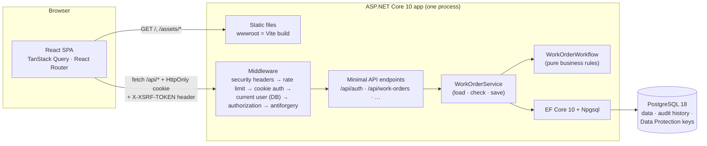
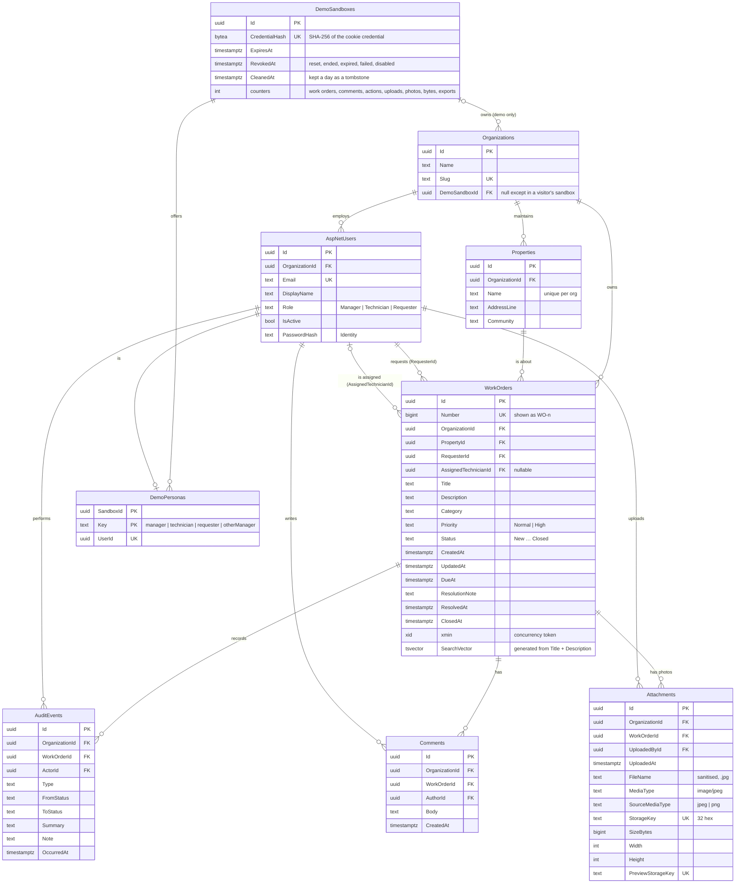
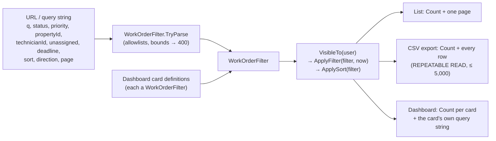
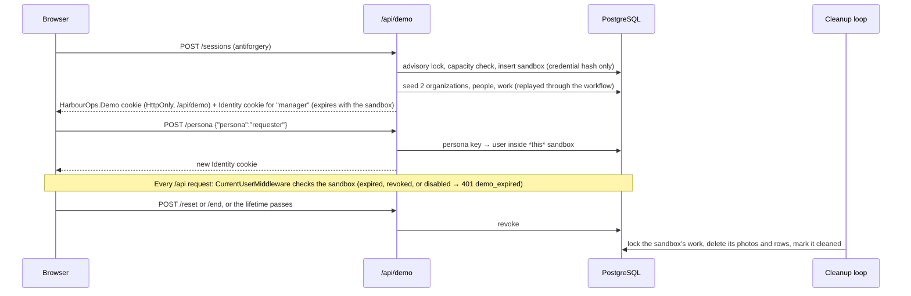
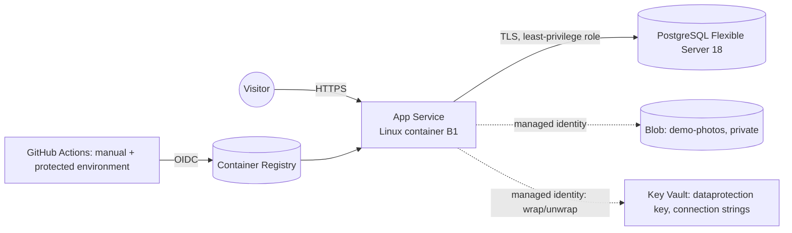
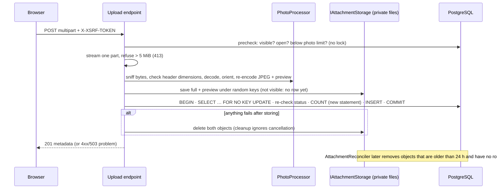
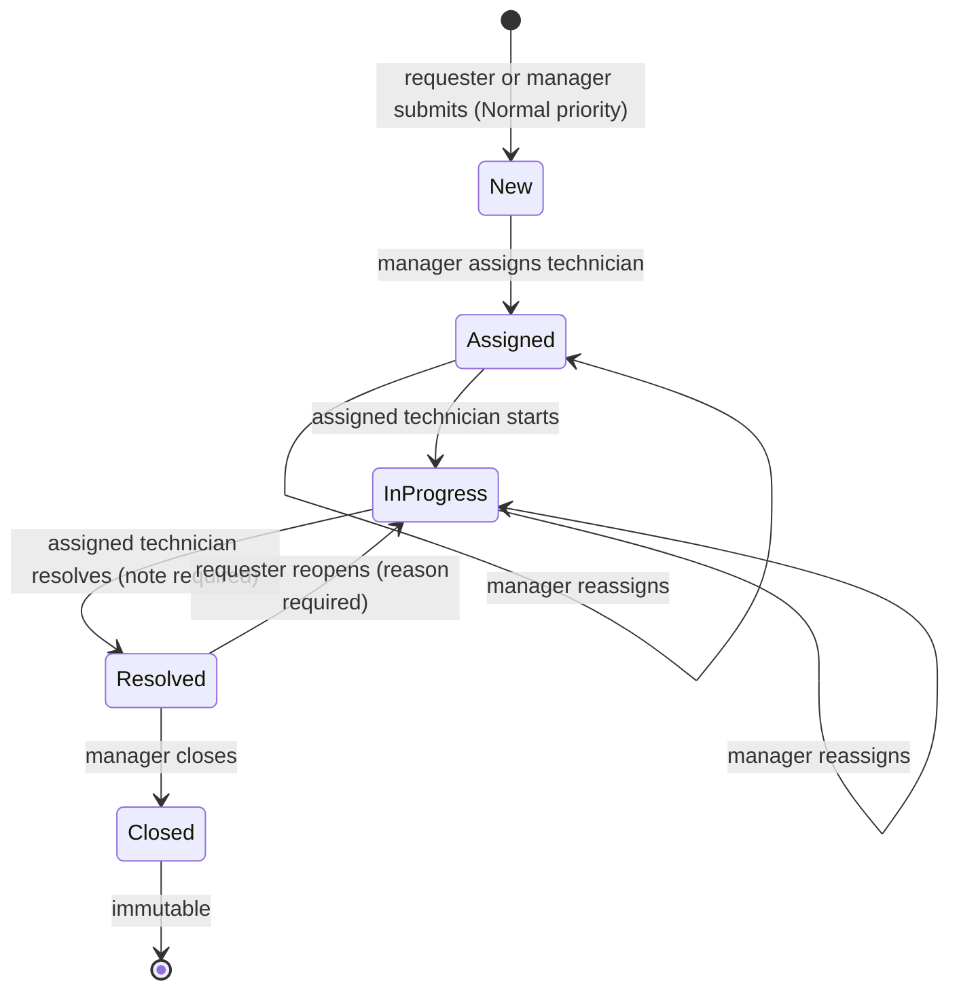
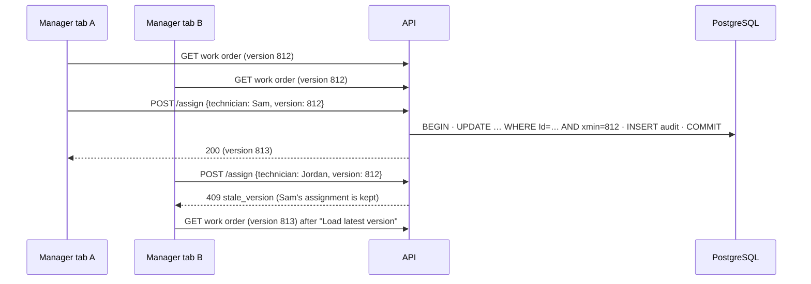

# Architecture

HarbourOps is deliberately simple: **one frontend, one backend application, one database**. In production the ASP.NET Core app serves both the compiled React app and the JSON API from the same origin, so there is no CORS configuration and no tokens in JavaScript.



During development, Vite serves the frontend on `localhost:5173` and forwards `/api` to the API on `localhost:5080`. The browser still sees a single origin.

## Backend layout

The code is organized **by feature**, not by technical layer. Each feature folder keeps its persistence entity (with its EF mapping), contracts, rules, and endpoints together:

```
HarbourOps.Api/
  Program.cs                      Composition root and middleware order
  Common/                         Cross-cutting HTTP pieces
    CurrentUser.cs                Loads the signed-in account from the database per request
    AntiforgeryMiddleware.cs      Validates X-XSRF-TOKEN on every unsafe /api request
    ApiResults.cs, Result.cs      Business failures → Problem Details
  Data/
    AppDbContext.cs               Identity user tables + domain tables + Data Protection keys
    Migrations/
    DatabaseStartup.cs            Optional migrate-on-start and demo seeding (config-driven); key-ring report
  Common/HostingConfiguration.cs  Azure identity, Key Vault key wrapping, and the secure-hosting guard
  Features/
    Auth/                         Identity, cookie, antiforgery, and rate-limit setup; login/logout/me
    WorkOrders/
      WorkOrder.cs, AuditEvent.cs Entities + EF configuration (constraints, indexes)
      WorkOrderWorkflow.cs        State machine + permissions (no HTTP, no DB)
      WorkOrderDeadlines.cs       24h / 72h deadline rules
      WorkOrderQueries.cs         VisibleTo(user): the single visibility rule
      WorkOrderService.cs         Loads, checks version, applies rule, saves atomically
      WorkOrderEndpoints.cs       HTTP mapping only
      WorkOrderContracts.cs       Request/response records (never entities)
      WorkOrderListQuery.cs       Search/filter/sort parameters → validated WorkOrderFilter
      Export/                     CSV escaping + formula-injection protection, streamed export
    Dashboard/                    Manager dashboard built from WorkOrderFilter definitions
    Comments/                     Comment entity, plain-text rules, keyset paging, FOR SHARE lock
    Attachments/                  Photo metadata, upload ordering and locking, authorised delivery
      Processing/PhotoProcessor   Content sniffing, header limits, decode → orient → re-encode (SkiaSharp)
      Storage/                    IAttachmentStorage boundary: private local directory or private Azure Blob container
      AttachmentReconciler        Scheduled removal of old, unreferenced stored objects
      UploadAdmission             Bounds uploads holding memory (processing + queue) before bodies are read
    Demo/                         Shared local demo accounts (DemoDataSeeder) and the replayable fictional template
      Sandbox/                    Per-visitor sandboxes: credential, personas, limits (DemoQuotas), cleanup
    Properties/, Users/, Organizations/
```

The layers each have one job:

| Layer | Responsibility | Knows about HTTP? | Knows about the DB? |
| --- | --- | --- | --- |
| Endpoints | Parse input, pick a status code | yes | no |
| Service | Load what the user may see, check the version, save | no | yes |
| Workflow | Decide whether an action is allowed, then change the entity | no | no |

There is no generic repository: EF Core's `DbContext` already *is* a unit of work and repository, and wrapping it would hide useful query features.

## Request pipeline

The order in `Program.cs` matters:

1. **Exception handler / status-code pages.** Every error becomes a Problem Details JSON response.
2. **Security headers.** `nosniff`, `X-Frame-Options: DENY`, a strict CSP outside Development, and a referrer policy.
3. **Static files.** Fingerprinted `/assets/*` are cached for a year; `index.html` is always revalidated.
4. **Rate limiter.** `POST /api/auth/login` is limited per client IP (10 per minute by default).
5. **Cookie authentication.** Identity's application cookie.
6. **Current-user middleware.** Loads organization, role, and active flag from the database. A deleted or deactivated account is signed out immediately.
7. **Authorization.** Endpoints marked `RequireAuthorization()` reject anonymous callers with a JSON 401, never a redirect.
8. **Antiforgery middleware.** Every POST/PUT/PATCH/DELETE under `/api` needs a valid `X-XSRF-TOKEN`, including sign-in and sign-out.
9. **Endpoints.** Unknown `/api/*` routes return a JSON 404; every other path falls back to the SPA's `index.html`.

## Data model



`DataProtectionKeys` (cookie encryption keys) and Identity's claims, logins, and tokens tables also live in the database.

**Organization-safe foreign keys.** `Properties` and `AspNetUsers` each have a unique key on `(OrganizationId, Id)`. Every reference from a work order, comment, or audit event uses a *composite* foreign key that includes `OrganizationId`. For example, `(OrganizationId, PropertyId) → Properties(OrganizationId, Id)`. So even if application code had a bug, PostgreSQL would refuse a Harbourview work order that points at a Cove Commons property or technician. An integration test proves this by bypassing the API.

**Check constraints** back up the workflow rules:

- Only `New` work may lack a technician.
- `Resolved` and `Closed` work must have a resolution note and a resolved time.
- `Closed` work must have a closed time.
- The due time must be after the creation time.
- Enum columns accept only known values.

**Indexes** match how the data is read:

| Index | Supports |
| --- | --- |
| `(OrganizationId, CreatedAt DESC, Id DESC)` | Default newest-first organization list, deterministic paging |
| `(OrganizationId, Status)` | Status filters |
| `(OrganizationId, AssignedTechnicianId, Status)` | A technician's queue |
| `(OrganizationId, RequesterId, CreatedAt)` | A requester's own requests |
| `(OrganizationId, DueAt) WHERE Status IN (open)` | Overdue and due-soon filters and dashboard counts (partial index) |
| `(OrganizationId, UpdatedAt DESC, Id DESC)` | "Recently updated" sort |
| GIN `(SearchVector)` | Full-text search |
| `Comments (OrganizationId, WorkOrderId, CreatedAt, Id)` | Comment keyset pagination |
| `Attachments (OrganizationId, WorkOrderId, UploadedAt, Id)` | A work order's photos in upload order |
| `Attachments (StorageKey)`, `(PreviewStorageKey)` unique | One row per stored object; reconciliation lookups |
| `AuditEvents (OrganizationId, WorkOrderId, OccurredAt)` | Activity timeline |

All timestamps are `timestamptz`, written in UTC by an injected `TimeProvider`. The frontend shows them in `America/Halifax`.

## Querying the work-order list

The list, the CSV export, and the manager dashboard all query work orders through the same path, so they apply identical definitions. Their numbers match whenever they are evaluated over the same data at the same `now`:



**How the pieces fit:**

- **Visibility first.** Results are always filtered by role and organization (`VisibleTo`) before search and filters, so counts never include records the user can't see.
- **One clock reading.** Each request reads `now` once and returns it as `asOf`.
- **Links reproduce counts.** `WorkOrderFilter.ToQueryString()` turns a filter back into URL parameters, so each dashboard card links to exactly the list it counted.

## Demo sandboxes

A visitor who chooses **Try the demo** gets a private copy of the fictional template: two organizations, their people, properties, and work. Each sandbox is ordinary data, isolated from every other visitor by the same organization boundaries that separate customers (decisions §37).



**Where each concern lives:**

| Concern | Where |
| --- | --- |
| Ownership and personas | `DemoSandboxService` (credential cookie, persona allowlist) |
| Expiry on every request | `CurrentUserMiddleware` |
| Limits | `DemoQuotas`: conditional UPDATEs in the write's transaction |
| Removal | `DemoSandboxCleaner` |
| Admin endpoints | None. Reset and end only revoke |

## Hosting in Azure (prepared, not deployed)



The same image runs locally and in Azure:

| Setting | Local (Compose, `Demo`) | Hosted (`PublicDemo`) |
| --- | --- | --- |
| Photo storage | Local directory | Blob container |
| Cookie keys | Unencrypted at rest | Wrapped by Key Vault |
| Shared demo accounts | On | Off |
| Migrations | At startup | Separate release step |

`PublicDemo` also refuses to start if any of the hosted settings is missing (decisions §43). See the [deployment runbook](deployment.md).

## Photo attachments

Photo bytes and photo metadata live in different places that can't share a transaction, so the upload is ordered to make a photo visible only once everything has succeeded:



**Delivery.** Photos are served only through `GET /api/work-orders/{id}/attachments/{attachmentId}/preview|content`. Every request re-checks current work-order visibility. Responses send `private, no-store`, `nosniff`, `same-origin` resource policy, and a header-safe `Content-Disposition`. The gallery loads previews only; the full image loads when a photo is opened in the dialog.

Photos, like comments, are supporting material: they never change a work order's Status, Version, UpdatedAt, or activity timeline. See [decisions §30–35](decisions.md#30-image-processing-with-skiasharp-mit).

## Workflow



Priority can be changed by a manager while work is open (New, Assigned, InProgress). The due date is recalculated from the *original creation time*. Every other transition is rejected.

The rules live in one pure class, `WorkOrderWorkflow`. Its `CheckAllowed(action, workOrder, user)` function is used in two places:

- **Enforcement.** Every command calls it before changing anything.
- **Presentation.** The detail response includes `allowedActions`, so the UI shows exactly the buttons the server would accept. Hiding a button is never the security boundary.

## Authorization model

| Question | Where it is answered |
| --- | --- |
| Who is calling? | Identity cookie → `CurrentUserMiddleware` loads the account from PostgreSQL |
| Which work orders can they see? | `WorkOrderQueries.VisibleTo(user)`: organization filter plus role filter (manager: all; technician: assigned to them; requester: created by them) |
| May they perform this action? | `WorkOrderWorkflow.CheckAllowed`: role, relationship (assigned technician, own request), and current status |
| Do referenced records belong to the same organization? | The service checks properties and technicians; composite foreign keys enforce it in the database |

The response codes follow from these questions:

- **404** when the record is not visible to the caller, whether it belongs to another organization or to a colleague. The response is identical to the one for a record that doesn't exist.
- **403** when the caller can see the record but their role does not allow the action.
- **422** when the action is not valid from the current status.
- **409** when the caller's copy is stale.

The client never sends an organization ID, role, or requester ID. If such fields are included in a request body, they are ignored, and a test proves it.

## Concurrency and atomicity



PostgreSQL's `xmin` system column changes on every row update, so it works as a free row version. The client sends the version it saw:

- If the version is already different when the request arrives, the API returns 409 immediately.
- If another update commits in the moment between that check and the save, the `UPDATE … WHERE xmin = @version` matches zero rows. EF Core raises a concurrency exception, which also becomes a 409.

The work-order update and its audit event are saved by **one** `SaveChanges` call, which EF Core wraps in a single transaction. A test installs a deferred PostgreSQL trigger that fails the audit insert at commit time. It then checks that the status change was rolled back as well.

## Frontend structure

```
frontend/src/
  api/client.ts        fetch wrapper: antiforgery header, one retry with a fresh token, Problem Details → ApiError
  api/types.ts         TypeScript mirrors of the API contracts
  app/                 router, layout, QueryClient (global 401 → signed-out handling)
  features/auth/       current user, login/logout, route guard, login page
  features/work-orders list, technician queue, create form, detail + actions + activity timeline
  components/          Button, FormField (label/hint/error wiring), Alert/Loading/Empty states, badges
  lib/format.ts        Halifax date formatting and labels
```

- **Server state:** TanStack Query; nothing is duplicated in client state.
- **Forms:** React Hook Form with Zod schemas that mirror the server rules. The server still validates, and its field errors are mapped back onto the matching inputs.
- **URL state:** list filters and the page number live in the URL (`?status=InProgress&page=2`).

## Testing strategy

| Level | Tool | What it proves |
| --- | --- | --- |
| Workflow unit tests | xUnit | The complete permission table (5 statuses × 5 kinds of actor), transitions, note validation, deadlines and due-soon boundaries, search parsing, filter round-trips, CSV escaping and formula neutralisation; photo processing and local storage; the Blob adapter against Azurite (round trip, no overwrite, foreign blobs never listed, private container, cancellation); the secure-hosting guard |
| API integration tests | xUnit + `WebApplicationFactory` + Testcontainers PostgreSQL 18 and Azurite | Unauthenticated 401s; organization isolation for lists, reads, writes, and pickers; cross-organization references rejected (by the app *and* by database constraints); requester and technician visibility; invalid transitions; resolution note required; audit + update atomicity (with a mutation check); stale and simultaneous updates; antiforgery (missing, forged, pre-login, other user's token); rate limiting; repeatable seeding; deadlines with a fake clock. **Milestone 2:** combined search and filters; parameter validation; stable sorting with tied values across pages; role and organization limits on results, counts, and filter choices; overdue and due-soon boundaries at ±1 µs; every dashboard number equal to its linked list; comment permissions, validation, keyset paging, and the comment-versus-close race (mutation-checked); export filters, order, headers, malicious cells, organization scope, and row limit. **Milestone 3:** valid JPEG and PNG uploads; deceptive, damaged, and unsupported content; size, dimension, and count limits; EXIF orientation applied and EXIF, GPS, and comments removed; isolation of photo metadata, previews, and downloads across organizations and roles (including after reassignment); missing antiforgery; malformed multipart bodies (no file part, empty file, file after four parts, missing closing boundary); uploads after closing; upload-versus-close and upload-versus-upload races (both mutation-checked); storage-failure and database-failure cleanup; reconciliation; response headers and hostile file names; malformed multipart bodies. **Milestone 4:** two visitors can't reach each other's records or photos as any persona; persona switching only reaches the owned sandbox (guessed credentials, smuggled IDs, and unknown keys refused); demo endpoints never authenticate or change ordinary accounts and personas can't use password sign-in; expired, reset, and ended sandboxes refuse retained cookies (photos, export, dashboard included); demo mode unreachable when disabled; concurrent starts respect capacity and concurrent writes respect per-sandbox limits (both mutation-checked); cleanup retries after a mid-way storage failure, is idempotent, and keeps other visitors' and ordinary photos; uploads in flight when a demo ends leave no row or file (both orderings, mutation-checked); antiforgery on every demo POST; per-client rate limit; bounded upload admission; the Blob provider end to end (access rules, headers, refused-upload cleanup, reconciliation, sandbox cleanup); Key Vault wiring; the secure-hosting guard and the committed PublicDemo configuration; health and version endpoints |
| Component tests | Vitest + React Testing Library | API client token and retry handling, including the refusal to retry as a different person after another tab changed the session; "Try the demo", persona switching, two-step reset with focus management, ending, and the ended screen; login validation and errors; only allowed actions rendered; 409 recovery flow; server validation errors mapped to fields; Halifax time formatting and deadline labels; URL filters, debounced search, page reset, Clear filters, and empty-state recovery; dashboard links; comment double-submit, failure, and closed states; export progress, limit, and failure |
| Accessibility | Playwright + axe-core | WCAG 2.2 A/AA scans of 12 screens and states (including the demo banner and ended screen), 320 px reflow, keyboard journeys, reduced motion (details in [accessibility.md](accessibility.md)) |
| End-to-end | Playwright against Docker Compose | Requester → manager → technician → manager in separate browser contexts; a requester's photo viewed by the manager (keyboard-opened dialog, Escape returns focus) and refused (404) to another organization; a dashboard card opening the matching filtered list; filters surviving refresh and Back; a requester's comment read by the manager; non-managers blocked from the dashboard and export (UI and API); a CSV download with Halifax timestamps; two visitors in separate browser contexts using "Try the demo": isolation of records and photos, persona switching, reset affecting only one visitor, and the ended screen; image processing in the running container (EXIF orientation and GPS/comment removal on stored bytes; in CI this is the linux/amd64 image on an x64 runner) |

The EF Core in-memory provider is **not** used anywhere. Behaviour that depends on the database, such as constraints, `xmin` concurrency, and transactions, is always tested against real PostgreSQL.
