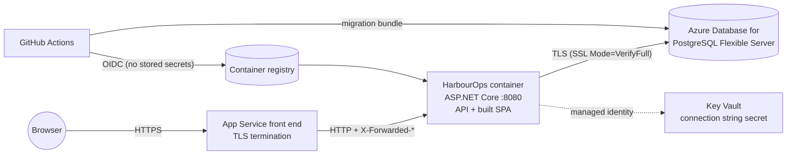

# Deploying to Azure App Service with Azure Database for PostgreSQL

This guide prepares HarbourOps for **Azure App Service (Linux)** with **Azure Database for PostgreSQL – Flexible Server**. Nothing in this repository creates cloud resources. The commands below are examples to run yourself when you are ready to pay for hosting, and every `<placeholder>` must be replaced.

## Target shape



- **One App Service app** runs the Docker image built by the repository `Dockerfile` (Web App for Containers). Alternatively, use the built-in .NET 10 Linux stack with `dotnet publish` output and the Vite build copied into `wwwroot`.
- **One Flexible Server** holds the database, including the Data Protection key ring.
- **Key Vault** holds the database password and connection string. App Service reads them through a managed identity.

> **PostgreSQL version.** The app is developed and tested on PostgreSQL 18. Before choosing, check which major versions Flexible Server offers in your region. If 18 is not available yet, choose the newest available major and run the integration tests against that version: change the Testcontainers image tag in `PostgresFixture` and run `dotnet test`.

## 1. Create the resources (example only, not executed)

```bash
RG=harbourops-rg
LOCATION=canadaeast          # or canadacentral
PG=harbourops-pg-<unique>
APP=harbourops-<unique>
PLAN=harbourops-plan
KV=harbourops-kv-<unique>

az group create -n $RG -l $LOCATION

# PostgreSQL Flexible Server (smallest burstable tier; private networking is better for production)
az postgres flexible-server create -g $RG -n $PG -l $LOCATION \
  --tier Burstable --sku-name Standard_B1ms --version <18-or-newest-available> \
  --admin-user <admin_user> --admin-password '<generated-strong-password>' \
  --public-access None    # then add a private endpoint / VNet integration, or narrow firewall rules
az postgres flexible-server db create -g $RG -s $PG -d harbourops

# App Service plan + container web app
az appservice plan create -g $RG -n $PLAN --is-linux --sku B1
az webapp create -g $RG -p $PLAN -n $APP --container-image-name <registry>/harbourops:<tag>
az webapp update -g $RG -n $APP --https-only true
az webapp config set -g $RG -n $APP --min-tls-version 1.2 --ftps-state Disabled \
  --generic-configurations '{"healthCheckPath": "/health/ready"}'
```

## 2. Database users and secrets

Use **two database roles**:

| Role | Privileges | Used by |
| --- | --- | --- |
| `harbourops_migrator` | Owns the schema (DDL) | The migration step in CI/CD only |
| `harbourops_app` | `SELECT, INSERT, UPDATE, DELETE` on the tables; `USAGE` on sequences | The running app |

That way, if the running app is ever compromised, it still cannot drop or alter tables.

Store the app's connection string in Key Vault and reference it from App Service. It then never appears in source control, pipeline logs, or the portal's plain-text settings.

```bash
az keyvault create -g $RG -n $KV -l $LOCATION --enable-rbac-authorization true
az keyvault secret set --vault-name $KV -n ConnectionStrings--Default --value \
  "Host=$PG.postgres.database.azure.com;Database=harbourops;Username=harbourops_app;Password=<app-password>;SSL Mode=VerifyFull"

az webapp identity assign -g $RG -n $APP
# Grant that identity the "Key Vault Secrets User" role on the vault, then:
az webapp config appsettings set -g $RG -n $APP --settings \
  'ConnectionStrings__Default=@Microsoft.KeyVault(VaultName=<kv>;SecretName=ConnectionStrings--Default)'
```

A later improvement is passwordless Microsoft Entra authentication for PostgreSQL, using the app's managed identity.

## 3. App settings

| Setting | Value | Why |
| --- | --- | --- |
| `ASPNETCORE_ENVIRONMENT` | `Production` | Production defaults: no demo data, no migrate-on-start, no OpenAPI UI, strict CSP, HSTS |
| `ConnectionStrings__Default` | Key Vault reference (above) | Secret stays in Key Vault |
| `ASPNETCORE_FORWARDEDHEADERS_ENABLED` | `true` | Azure terminates TLS. This makes ASP.NET Core trust `X-Forwarded-Proto`/`-For`, so HTTPS detection, Secure cookies, HSTS, and per-client-IP rate limiting see the real values |
| `WEBSITES_PORT` | `8080` | The container listens on 8080 |
| `Security__CookieSecurePolicy` | *(leave unset)* | The default `Always` marks cookies Secure |
| `Database__ApplyMigrationsOnStartup` | *(leave unset)* | Migrations are a separate deployment step (below) |
| `DemoData__Enabled` | *(leave unset)* | Demo accounts must not exist in production |

## 4. HTTPS

- **App Service:** turn on *HTTPS Only* and set the minimum TLS version to 1.2 (step 1). App Service supplies the certificate for `*.azurewebsites.net`; add a custom domain with a free managed certificate if you have one.
- **The app:** it sends `Strict-Transport-Security` outside Development (`UseHsts`), and its cookies are `Secure`, `HttpOnly`, and `SameSite=Strict`.
- **The database:** connections use `SSL Mode=VerifyFull`, which encrypts traffic *and* checks the server certificate.

## 5. Database migrations

Migrations run **before** the new app version receives traffic, as an explicit, logged step. Running them at app startup would mean several instances racing each other and the app needing DDL rights.

Option A (recommended) is an **EF Core migration bundle**, built once in CI:

```bash
dotnet tool restore
dotnet ef migrations bundle --project backend/HarbourOps.Api --configuration Release \
  --self-contained -r linux-x64 -o efbundle
# In the release job, with the migrator's connection string from a secret store:
./efbundle --connection "$MIGRATOR_CONNECTION_STRING"
```

Option B is an idempotent SQL script that a reviewer can read before applying:

```bash
dotnet ef migrations script --idempotent --project backend/HarbourOps.Api -o migrate.sql
psql "$MIGRATOR_CONNECTION_STRING" -f migrate.sql
```

Design migrations to be backward compatible, so the old app version keeps working until the swap. For example, add a nullable column first and make it required in a later release. With a staging slot: deploy to the slot, migrate, warm up, then swap.

## 6. Data Protection keys

ASP.NET Core encrypts the auth and antiforgery cookies with Data Protection keys. If each instance had its own keys, or lost them on restart, users would be signed out at random. HarbourOps already handles the essentials:

- **Persisted:** `PersistKeysToDbContext<AppDbContext>()` stores the key ring in PostgreSQL (`DataProtectionKeys` table), so it survives restarts and redeployments.
- **Shared:** every instance reads the same table, so scaling out works.
- **Isolated:** `SetApplicationName("HarbourOps")` keeps keys separate from other apps.

**Recommended production hardening (not yet in code):** encrypt the key ring at rest with Key Vault. Add the `Azure.Extensions.AspNetCore.DataProtection.Keys` and `Azure.Identity` packages, then:

```csharp
builder.Services.AddDataProtection()
    .SetApplicationName("HarbourOps")
    .PersistKeysToDbContext<AppDbContext>()
    .ProtectKeysWithAzureKeyVault(new Uri("<key-identifier-uri>"), new DefaultAzureCredential());
```

This also removes the startup warning "No XML encryptor configured".

## 7. Building and shipping the image

The production image is multi-stage:

- **Node 24** builds the frontend.
- **.NET SDK 10.0.402** runs `dotnet restore --locked-mode` and `dotnet publish`.
- **The runtime image** is `aspnet:10.0.13-noble-chiseled`: no shell or package manager, running as a non-root user.

Example release job outline (GitHub Actions):

1. Authenticate to Azure with **OIDC federated credentials** (`azure/login`). No long-lived secrets are stored in GitHub.
2. Build and push `harbourops:<git-sha>` to Azure Container Registry or GitHub Container Registry.
3. Run the migration bundle (step 5) against production.
4. Point the web app or staging slot at the new image tag, wait for `/health/ready`, then swap.

## 8. Running a public demo safely

A public portfolio demo should be a **separate deployment** with its **own database**, never a production database with demo mode switched on.

| Setting | Value |
| --- | --- |
| `ASPNETCORE_ENVIRONMENT` | `Demo` (loads `appsettings.Demo.json`: migrate on start + seed fictional data) |
| `DemoData__Password` | The publicly documented demo password, stored as an app setting |
| Database | A dedicated, smallest-tier database containing only fictional data |

Things to know:

- **Visibility:** the login page lists the demo accounts only in this mode (`GET /api/demo/accounts` returns 404 otherwise).
- **Abuse:** anyone can change demo data, or lock a demo account for 5 minutes by failing to sign in. Reset the demo database on a schedule (drop and recreate, then restart the app to re-seed). Per-visitor sandboxes are on the roadmap.
- **Warning log:** if `DemoData:Enabled` is ever true while `ASPNETCORE_ENVIRONMENT=Production`, the app logs a warning at startup. Treat that warning as an incident.

## 9. Operations checklist

- **Health check:** `/health/ready` checks that the database is reachable, and App Service replaces instances that fail it. `/health/live` only checks that the process responds.
- **Logs:** JSON console logs go to the App Service log stream. Send them to Log Analytics with a diagnostic setting. They never contain passwords, cookies, or request bodies.
- **Scale-out:** cookies keep working across instances because the keys are shared. The sign-in rate limiter works per instance, so the effective limit is 10 per minute per instance. Use Azure Front Door or WAF rate limiting for a global limit.
- **Backups:** Flexible Server takes automatic backups. Set retention and geo-redundancy to match how much data you can afford to lose.
