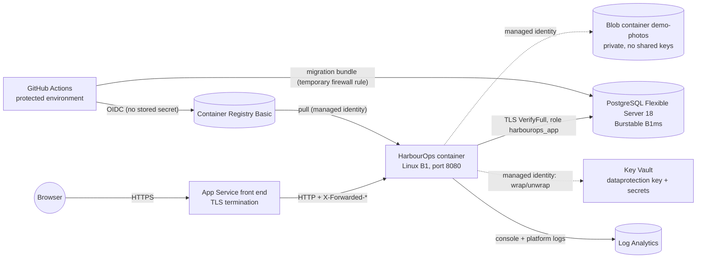

# Deploying the HarbourOps public demo to Azure

> **The live demo does not use this path.** It runs for free on Render and Supabase ([deployment-render.md](deployment-render.md), decisions §46). This Azure runbook remains a documented, tested alternative that has never been deployed.

This is the runbook for one deployment path:
- **App Service** (Linux, the repository's container);
- **Azure Database for PostgreSQL Flexible Server**;
- a private **Blob Storage** container for demo photos;
- **Key Vault** for the cookie-encryption key and connection strings;
- **managed identities**, plus GitHub **OIDC** for deployment.

**Nothing in this repository has been deployed.** No Azure resource has been created, and the deploy workflow has never run. CI runs on GitHub, and the `production` environment and its OIDC subject are set up (§1, §5). Every command below is for you to run when you decide to pay for hosting, and every `<placeholder>` must be replaced.

## 1. What is verified, and how

| Area | Local (this machine) | Emulator | CI (GitHub Actions) | Real Azure |
| --- | --- | --- | --- | --- |
| App, sandboxes, photos, tests | Yes: 306 backend, 58 frontend, 17 browser tests | | **Passed**, same counts ([run 40544241970](https://github.com/beaprogram/harbourops/actions/runs/40544241970), 2026-10-27) | **Not run** |
| Linux x64 image processing | Under QEMU emulation (17/17 smoke checks) | | **Passed natively:** `linux/amd64` image on an `x86_64` runner, both photo browser tests | **Not run** |
| Blob Storage adapter | | Azurite 3.37 (9 tests) | **Passed** against Azurite (still emulator evidence) | **Not run** |
| Key Vault key wrapping | Wiring only (which encryptor is used) | No Key Vault emulator exists | | **Not run** |
| Bicep templates | Compiled and linted (Bicep 0.48.1) | | `infrastructure` job **passed** | **Not deployed** |
| Workflows (`ci.yml`, `deploy.yml`, `oidc-subject.yml`) | actionlint 1.7.12 clean | | `ci.yml` and `oidc-subject.yml` **ran**; `deploy.yml` **not run** (it needs Azure) | |
| Migrations and the least-privilege role | Rehearsed on PostgreSQL 18.6 in Docker | | | **Not run** |

## 2. Shape



Everything is defined in [`infra/main.bicep`](../infra/main.bicep), with one module for the database firewall.

**Choices,** checked against current Microsoft documentation on 2026-10-26 (decisions §44):

- **PostgreSQL 18 is generally available on Flexible Server** (minor version 18.6), so production matches development and tests.
- **App Service B1** (1 core, 1.75 GB) was sized from measured memory: one photo decode at a time peaked at 496 MiB ([benchmark](benchmarks/photo-memory/README.md)).
- **Pulling with a managed identity** requires ACR to accept ARM-audience tokens; the template enables that.
- **The database endpoint is public, behind a firewall.** It admits only the app's outbound addresses, plus the deploy runner for the length of the migration. Private networking costs more and is listed under hardening (section 15).

## 3. Cost estimate (2026-10-26, Canada Central, USD, retail list prices)

**Sources:** retail prices are from the [Azure Retail Prices API](https://prices.azure.com/api/retail/prices). The pricing pages for [App Service (Linux)](https://azure.microsoft.com/pricing/details/app-service/linux/), [PostgreSQL Flexible Server](https://azure.microsoft.com/pricing/details/postgresql/flexible-server/), [Blob Storage](https://azure.microsoft.com/pricing/details/storage/blobs/), [Key Vault](https://azure.microsoft.com/pricing/details/key-vault/), [Container Registry](https://azure.microsoft.com/pricing/details/container-registry/), [Azure Monitor](https://azure.microsoft.com/pricing/details/monitor/), and [Bandwidth](https://azure.microsoft.com/pricing/details/bandwidth/) explain the meters.

**Assumptions:** a month is 730 hours, everything runs all month, no reservations or savings plans, light demo traffic, and prices exclude tax.

**Rechecked on 2026-10-27:** every meter below is unchanged. If your account is billed in Canadian dollars, the API's CAD prices for the same meters total about **CA$51 a month**: B1 CA$18.61, B1ms CA$19.13, 32 GB storage CA$5.73, and the registry CA$7.18.

| Resource | Meter | Monthly |
| --- | --- | --- |
| App Service plan B1 (Linux) | $0.018 per hour | $13.14 |
| PostgreSQL Flexible Server, Burstable B1ms | $0.0185 per hour | $13.51 |
| PostgreSQL storage, 32 GB | $0.1265 per GB-month | $4.05 |
| PostgreSQL backups, 7 days | Free up to the provisioned 32 GB ([docs](https://learn.microsoft.com/azure/postgresql/flexible-server/concepts-backup-restore)) | $0.00 |
| Container Registry, Basic | $0.1666 per day | $5.07 |
| Registry image storage (~1 GB of tags) | $0.10 per GB-month if billed | ≤ $0.10 |
| Blob Storage, Hot LRS (< 1 GB of demo photos) | $0.02 per GB-month; writes $0.055, reads $0.0044 per 10,000 | ≈ $0.10 |
| Key Vault, Standard (software key, two secrets) | $0.03 per 10,000 operations | < $0.01 |
| Log Analytics | First 5 GB per billing account per month free, then $2.76 per GB | $0.00 if under 5 GB |
| Outbound data | First 100 GB per month free, then $0.087 per GB | $0.00 if under 100 GB |
| **Total** | | **≈ $36 per month (≈ $0.05 per hour)** |

**This is not free.** Every billable meter above costs money from the first hour. Free-account credits or promotional offers may cover it for a while, but that depends on your account and isn't assumed here.

**To stop paying,** run the teardown in section 14. Stopping the web app alone doesn't stop the plan's charges.

## 4. Before you start

- **Azure CLI** with Bicep (`az bicep install`), and an Azure subscription in which you hold **Owner**, or Contributor plus Role Based Access Control Administrator, on the resource group (the template creates role assignments).
- **A public GitHub repository.** On GitHub Free, Pro, and Team:
  - **required reviewers** for an environment are available only in **public** repositories;
  - on Free, **environment variables** are too. The deploy workflow relies on both.

  A private repository would need GitHub Enterprise for required reviewers. ([GitHub docs: deployments and environments](https://docs.github.com/en/actions/reference/workflows-and-actions/deployments-and-environments), checked 2026-10-26.)
- **Approving as a solo maintainer.** You can approve your own deployments as long as the environment's **"Prevent self-reviews"** option stays off; only one listed reviewer needs to approve.
- **`psql`** (libpq 16 or newer) for the one-time role script.
- **Two strong passwords**, generated and kept in your password manager: the PostgreSQL administrator password and the app role's password. They are typed with `read -s` below, so they never appear in shell history, logs, or files, and they are stored only in Key Vault.

## 5. Repository, environment, and the OIDC subject

1. **Create the repository and push.** Wait for **CI** to pass on `main`.
2. **Create the environment.** Open **Settings → Environments → New environment**, name it `production`, and set:
   - **Required reviewers:** yourself. Leave "Prevent self-reviews" off if you are the only maintainer.
   - **Deployment branches and tags:** "Selected branches and tags": `main` and the tag pattern `v*`. The deploy job also refuses any other ref.
3. **Read the exact OIDC subject.** Run **Actions → Show OIDC subject (setup helper) → Run workflow**, approve it, and copy the printed `sub` value.

   **Why copy it rather than write it:**
   - **The format depends on the repository's age.** Repositories created after 15 July 2026 default to an **immutable** subject that embeds the owner and repository IDs (`repo:OWNER@OWNER-ID/REPO@REPO-ID:…`), and GitHub's documentation doesn't show its environment form.
   - **Azure needs an exact match** and accepts no wildcards. A wrong subject is accepted when it is configured, then fails silently at sign-in ([Microsoft docs](https://learn.microsoft.com/entra/workload-id/workload-identity-federation-considerations)).

   The helper prints only the token's claims, never the token itself.

## 6. Provision the resources

```bash
az login
az account show --query "{subscription:name, id:id, tenant:tenantId}"   # confirm the subscription
az group create --name <rg> --location canadacentral

cp infra/main.parameters.example.json infra/main.parameters.json   # git-ignored
# Edit it: namePrefix, githubOidcSubject (from section 5), budgetMonthlyAmount, budgetContactEmails.

read -s -p "PostgreSQL admin password: " PG_ADMIN_PASSWORD; echo
read -s -p "App role password: " APP_DB_PASSWORD; echo

# Preview first: what would be created, changed, or deleted
az deployment group what-if --resource-group <rg> --template-file infra/main.bicep \
  --parameters @infra/main.parameters.json \
  --parameters postgresAdminPassword="$PG_ADMIN_PASSWORD" appDbPassword="$APP_DB_PASSWORD"

az deployment group create --resource-group <rg> --template-file infra/main.bicep \
  --parameters @infra/main.parameters.json \
  --parameters postgresAdminPassword="$PG_ADMIN_PASSWORD" appDbPassword="$APP_DB_PASSWORD"
```

**Outputs.** `webAppName`, `webAppUrl`, `registryName`, `registryLoginServer`, `postgresServerName`, `keyVaultName`, `deployClientId`, `tenantId`, and `subscriptionId` are identifiers, not secrets. Section 7 uses them.

**Budget alert.** With `budgetContactEmails` set, the template creates a monthly budget on the resource group that emails at 80% of actual spend and at 100% of forecast spend. **A budget is a notification, not a cap:** Azure keeps running and billing the resources when it is exceeded. To stop spending, use the teardown in section 14.

**The placeholder image.** The site starts with an image (`harbourops:bootstrap`) that doesn't exist yet, so it reports unhealthy until the first release (section 8).

## 7. Database role and environment variables (once)

**The least-privilege role.** The app connects as `harbourops_app`, which can read and write rows but cannot create, alter, or drop tables. Migrations run as the administrator, which owns the schema. The script sets default privileges, so it works before or after the first migration; both orders were rehearsed.

```bash
MYIP=$(curl -fsS https://api.ipify.org)
az postgres flexible-server firewall-rule create -g <rg> --name <postgresServerName> \
  --rule-name operator-once --start-ip-address "$MYIP" --end-ip-address "$MYIP"

PGPASSWORD="$PG_ADMIN_PASSWORD" psql \
  "host=<postgresServerName>.postgres.database.azure.com dbname=harbourops user=harbourops_admin sslmode=verify-full sslrootcert=system" \
  -v app_password="$APP_DB_PASSWORD" -f infra/sql/create-app-role.sql

az postgres flexible-server firewall-rule delete -g <rg> --name <postgresServerName> --rule-name operator-once --yes
unset PG_ADMIN_PASSWORD APP_DB_PASSWORD
```

**Environment variables.** In the `production` environment, add these as variables, not secrets: they are identifiers.

| Variable | Value |
| --- | --- |
| `AZURE_CLIENT_ID` | `deployClientId` output |
| `AZURE_TENANT_ID` | `tenantId` output |
| `AZURE_SUBSCRIPTION_ID` | `subscriptionId` output |
| `AZURE_RESOURCE_GROUP` | `<rg>` |
| `ACR_NAME` / `ACR_LOGIN_SERVER` | `registryName` / `registryLoginServer` outputs |
| `WEBAPP_NAME` / `WEBAPP_URL` | `webAppName` / `webAppUrl` outputs |
| `POSTGRES_SERVER` | `postgresServerName` output |
| `KEY_VAULT_NAME` | `keyVaultName` output |

**No Azure secret goes into GitHub.** The deploy identity trusts only the exact subject from section 5, so pull requests, other branches' jobs, and forks can't use it.

**First sign-in.** A new federated credential can take a few minutes to propagate. If the first sign-in fails with `AADSTS70021`, wait and re-run.

## 8. Release (each time)

Run **Actions → Deploy public demo → Run workflow** on `main` (or a `v*` tag). [`deploy.yml`](../.github/workflows/deploy.yml) then:

1. **Reruns the whole CI** on that exact commit: the backend with PostgreSQL and Azurite, the frontend, Bicep, and end-to-end, accessibility, and x64 image checks.
2. **Waits for a reviewer's approval** (the `production` environment), and refuses any ref other than `main` or a `v*` tag.
3. **Builds the release image once** (`linux/amd64`, commit SHA baked in). It runs it with a throwaway database and runs the photo-processing, photo, demo-isolation, and workflow browser tests against **that exact image** on the x64 runner.
4. **Signs in to Azure with OIDC,** pushes the tested image, and records its **digest** (`…/harbourops@sha256:…`) in the run summary.
5. **Builds an EF Core migration bundle,** opens the database firewall for its runner only, applies migrations as the schema owner, and closes the firewall again even if a step failed.
6. **Points the web app at the image by digest,** which is immutable, then waits until `/health/version` reports the commit SHA and `/health/ready` passes.

**Adding or editing workflow files never deploys.** The only trigger is a manual run.

**Check the release by hand:**
- open the site;
- choose **Try the demo**;
- confirm the banner;
- switch persona;
- upload a photo;
- end the demo.

## 9. Configuration the template sets

| App setting | Value | Why |
| --- | --- | --- |
| `ASPNETCORE_ENVIRONMENT` | `PublicDemo` | Loads [`appsettings.PublicDemo.json`](../backend/HarbourOps.Api/appsettings.PublicDemo.json): sandboxes on, shared accounts off, one photo decode at a time, and the secure-configuration guard |
| `ASPNETCORE_FORWARDEDHEADERS_ENABLED` | `true` | App Service terminates TLS, so the app must trust `X-Forwarded-Proto`/`-For` for HTTPS detection, Secure cookies, HSTS, and per-client rate limits |
| `WEBSITES_PORT` | `8080` | The container's port |
| `WEBSITES_ENABLE_APP_SERVICE_STORAGE` | `false` | Photos are in Blob Storage, so `/home` isn't needed |
| `ConnectionStrings__Default` | `@Microsoft.KeyVault(SecretUri=…)` | Resolved by App Service with the app's identity; never in plain settings |
| `DataProtection__KeyVaultKeyUri` | Versionless key URI | Wraps cookie-encryption keys (section 11) |
| `Attachments__Storage__AzureBlob__ServiceUri` | Blob endpoint | Photos, through the app's identity |
| `Azure__ManagedIdentityClientId` | The app identity's client ID | Which user-assigned identity to use |

**The secure-configuration guard.** With `Hosting:RequireSecureConfiguration` set by `PublicDemo`, the app **refuses to start** unless all of these hold:
- the Key Vault key is configured;
- cookies are always Secure;
- the shared accounts are off;
- migrations don't run at startup;
- storage is Blob with a managed-identity endpoint;
- no developer credential is used.

A missing setting therefore fails loudly instead of running exposed (decisions §43).

**Limits you may tune** (`DemoSandbox__*`):

| Setting | Default |
| --- | --- |
| `Lifetime` | 1 hour |
| `MaxActiveSandboxes` | 50 |
| `MaxCreationsPerHour` | 200 |
| `CreationsPerClientPerHour` | 10 |
| Per sandbox | 20 requests, 60 comments, 200 workflow changes, 20 upload attempts, 12 photos, 25 MiB of photos, 20 exports |

## 10. Database migrations

**A controlled step.** Migrations run in the deploy job, before the new image is switched in, as the schema owner. The app never runs DDL in the hosted configuration.

**Each migration must be backward compatible with the previous image.** Add nullable columns and new tables first; tighten or drop them in a later release. `DemoSandboxes` follows this: one nullable column and two new tables, so the milestone 3 image still runs against the migrated schema.

**Rehearsed locally.** Against PostgreSQL 18.6, the bundle applied all five migrations, and a second run reported "No migrations were applied." The app then ran a full visitor journey as `harbourops_app`: start, upload, switch, create, comment, workflow change, export, reset, end, and background cleanup, with no permission errors.

## 11. Data Protection keys (Key Vault wrapping)

**Where the keys are.**
- **Storage:** the cookie-encryption key ring stays in PostgreSQL (`DataProtectionKeys`), as since milestone 1, so it survives restarts and redeployments and is shared by every instance.
- **Wrapping:** each new key is wrapped with the Key Vault key `dataprotection` (RSA 2048) before it is stored.

**Access.** The app identity has **Key Vault Crypto Service Encryption User** on that key only: get, wrap, and unwrap. Microsoft's guide lists Key Vault Crypto User, a broader role; this narrower one covers the same three operations.

**Application name.** `DataProtection:ApplicationName` is `HarbourOps.PublicDemo` for the hosted demo. Never change it on a running deployment: every cookie becomes unreadable, so everyone is signed out once.

**Rotation and retention.**
- **Data Protection keys:** each lives 90 days (the framework default) and is replaced automatically. Expired keys stay in the table so older cookies can still be read until they expire.
- **The Key Vault key:** rotate it with `az keyvault key rotate --vault-name <kv> --name dataprotection`. The app uses the **versionless** URI, so new keys are wrapped with the new version.
- **Keep older versions enabled** for as long as any key they wrapped is still in the table (90 days plus the longest session).

**Backup and recovery.**
- **PostgreSQL backups** hold the wrapped key ring.
- **Key Vault** keeps deleted keys and vaults for 7 days (soft delete), and **purge protection** stops anyone destroying them early.
- **Restoring the database is only useful if the Key Vault key it was wrapped with still exists.** A database backup without the vault key is useless for sessions. That only means signing in again: no application data depends on these keys.

**If Key Vault is unavailable.**
- Keys already loaded keep working from memory.
- Creating a new key or loading an unseen one fails, so sign-in fails.
- The `data-protection` check makes `/health/ready` fail, so App Service stops routing traffic to that instance.

**Existing unencrypted keys.**
- **Nothing is re-encrypted or deleted.** Turning on wrapping only affects keys created afterwards. Keys created before (for example by a deployment that ran without Key Vault) stay readable, so existing sessions keep working.
- **The old default key keeps protecting new cookies until it expires.** Enabling wrapping does not create a new key, so the current unencrypted key, if any, remains the default for up to 90 days after it was created. The next key, created automatically before that one expires, is wrapped.
- **The app reports them.** At startup it logs how many keys are stored unencrypted.
- **Retiring them** is a deliberate operator step:
  1. Note the time wrapping was enabled.
  2. Find the latest `expirationDate` among the unencrypted keys (in their XML), and add 8 hours: the longest session, because a sliding session is reissued with the default key while it is used. After that, no live cookie needs an unencrypted key.
  3. Back up the database, then delete only the unencrypted rows (those whose XML contains no `encryptedSecret`) in a transaction, checking the count first:

     ```sql
     BEGIN;
     SELECT count(*) FROM "DataProtectionKeys" WHERE "Xml" NOT LIKE '%<encryptedSecret%';
     DELETE FROM "DataProtectionKeys" WHERE "Xml" NOT LIKE '%<encryptedSecret%';
     COMMIT;   -- or ROLLBACK if the count isn't what you expected
     ```

  4. Restart the app. The startup log should report 0 unencrypted keys.

  Deleting earlier than step 2 would sign out anyone whose cookie still uses an old key: it is safe for data, but disruptive. A brand-new hosted deployment that had Key Vault from its first start has nothing to retire.

**Local development** has no Key Vault. ASP.NET Core's "No XML encryptor configured" warning is expected there and only there.

## 12. Photo storage

**Where photos are.**
- **The container:** `demo-photos` is private.
- **The account:** public blob access and shared keys are both disabled.
- **Access:** the app identity has Storage Blob Data Contributor on that container only.
- **Delivery:** photos are always streamed through the app's authorized endpoints. There are no public or SAS URLs, so reassignment and demo expiry take effect on the next request.

**Recovery.** Soft delete keeps deleted blobs and containers for 7 days.

**Reconciliation.**
- **The job:** the existing reconciler runs every 6 hours. It deletes only blobs that are named like storage keys, are older than 24 hours, and have no database row. Anything else in the container is never touched.
- **Sandbox cleanup:** each sandbox's photos are deleted by its own cleanup (decisions §39).

**Backups.** Demo photos are temporary by design: every sandbox is deleted within an hour or so. So no blob backup is configured beyond soft delete. For a deployment with real photos:
1. Back up the database first, then the blobs (blob versioning, or Azure Backup for blobs).
2. Restore both to the same point.
3. Turn reconciliation off (`Attachments__Cleanup__Enabled=false`) until you've checked consistency.

## 13. Health, logs, and rollback

**Health.**
- **`/health/live`:** the process answers.
- **`/health/ready`:**
  - Database reachable, and cookie keys usable: either failing makes it Unhealthy.
  - Photo storage is reported as Degraded, not Unhealthy, because the rest of the app works without it.
- **`/health/version`:** the commit SHA the image was built from.
- **App Service** probes `/health/ready` and replaces instances that fail it.

**Logs.**
- **Shipped:** the app's JSON console logs (method, path, status, and duration; never bodies, cookies, headers, or demo credentials) and App Service platform logs go to Log Analytics.
- **Deliberately off:** `AppServiceHTTPLogs`, because that table has a `Cookie` column and would record session cookies.
- **Retention:** 30 days.

**Rollback.**
- **One command:** `az webapp config container set -g <rg> -n <webAppName> --container-image-name <acr>.azurecr.io/harbourops@sha256:<previous-digest>`. Each release's digest is in its workflow run summary.
- **Why it's safe:** migrations are backward compatible (section 10), so the previous image runs against the newer schema.
- **Schema rollback** is never automatic. If you truly must revert a migration, restore the database to a point in time (it is restored as a **new** server) and repoint the connection-string secret.

## 14. Teardown

1. **Optional: end the demo cleanly.** Set `DemoSandbox__Enabled=false`. The cleanup loop ends every sandbox and deletes its data and photos.
2. **Delete the resource group:** `az group delete --name <rg>`. This removes every resource, including the database and **its backups**, which can't be recovered after the server is deleted.
3. **Key Vault** stays soft-deleted for 7 days, and purge protection keeps its name reserved until then. That costs nothing.
4. **In GitHub,** delete the `production` environment's variables, or the environment itself.
5. **Check for leftovers** with `az resource list --resource-group <rg>` (it should fail with "not found"). Then check the next invoice.

## 15. Not done yet (hardening)

- **Private networking:**
  - App Service VNet integration;
  - a private endpoint for PostgreSQL (or VNet injection);
  - private endpoints or service-endpoint firewalls for Storage and Key Vault.

  Cost: about US$7 a month per private endpoint, plus private DNS zones.
- **Passwordless database access:** Microsoft Entra authentication for PostgreSQL with the app's managed identity, instead of a password in Key Vault.
- **A global rate limit:** Azure Front Door or a WAF in front. The demo's per-client limits are in-process, so they are per instance.
- **Alerts:** on `/health/ready` failures, 5xx rates, database CPU, and Key Vault failures.

## Local configurations (not for hosting)

| Configuration | Used by | What it does |
| --- | --- | --- |
| `appsettings.Development.json` | `dotnet watch` | Migrations on start, shared demo accounts, local photo directory, Secure cookies only over HTTPS |
| `appsettings.Demo.json` | `docker compose` | Same, plus sandboxes enabled with a looser per-client creation limit for repeated browser-test runs |
| `appsettings.PublicDemo.json` | Azure only | Refuses to start without Key Vault, Blob Storage with a managed identity, and Secure cookies |
